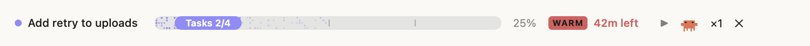
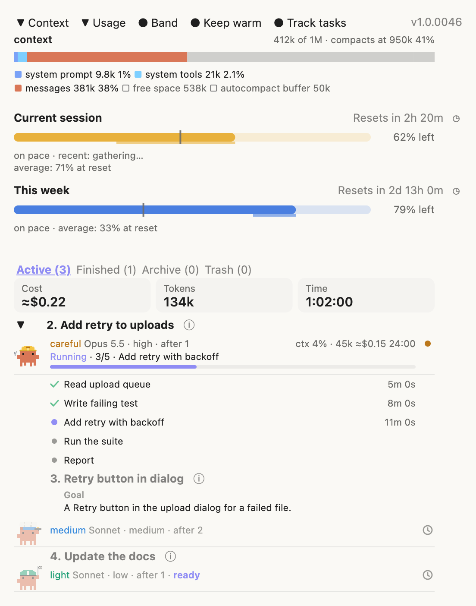
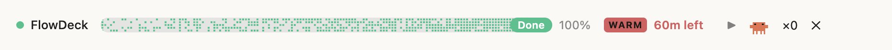
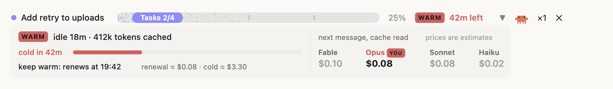
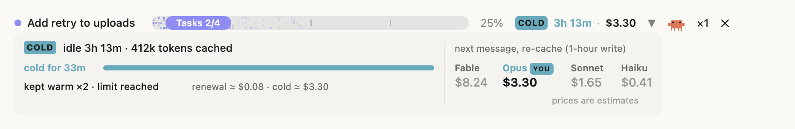
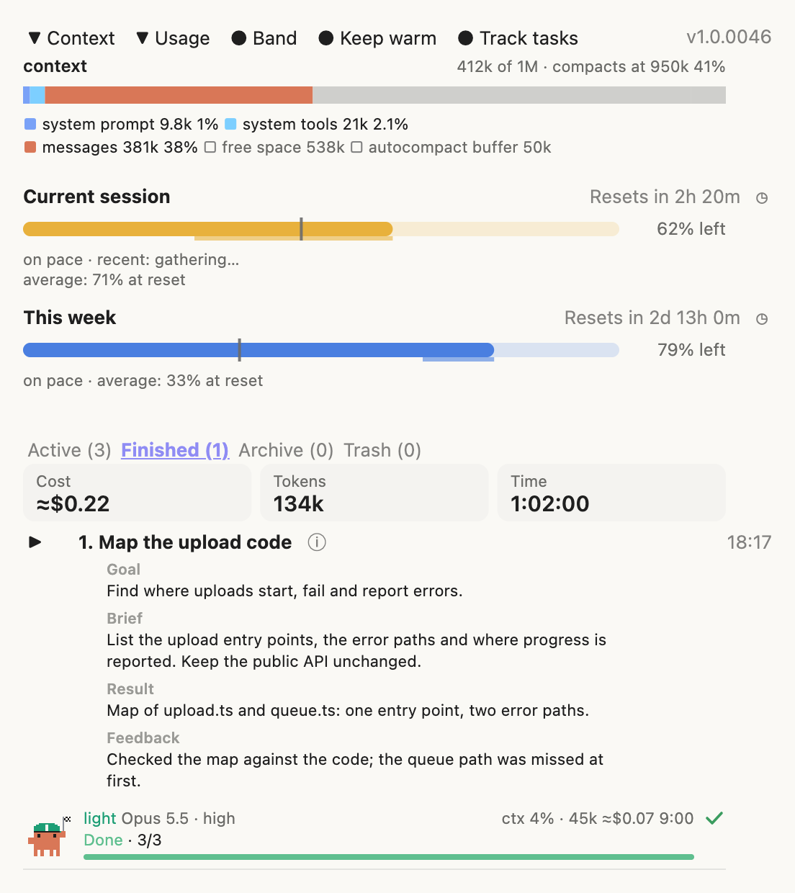
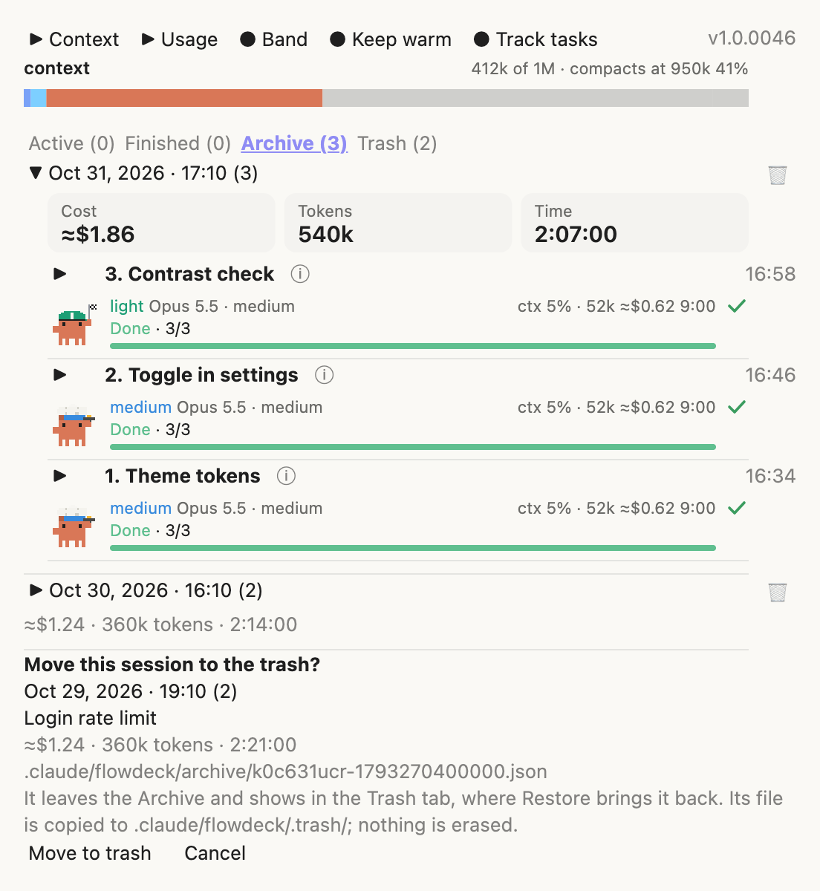
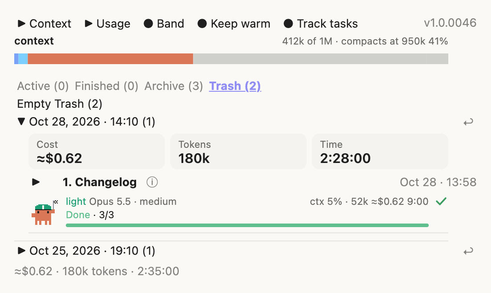
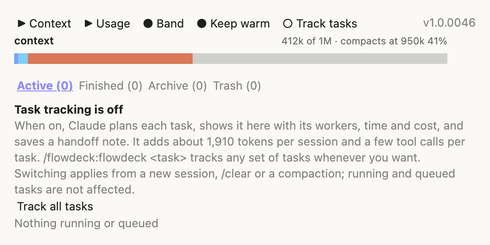

# flowdeck

A Claude Code mod that runs a session's work as a planned, delegated flow and shows it live: a band above the prompt, a side panel with the agents, context and usage, and an archive of past flows.

<picture>
  <source media="(prefers-color-scheme: dark)" srcset="docs/images/band-running-dark.png">
  
</picture>

<picture>
  <source media="(prefers-color-scheme: dark)" srcset="docs/images/panel-active-dark.png">
  
</picture>

The screenshots are rendered from the mod's own drawing code with sample data (see [Screenshots](#screenshots)); nothing in them comes from a real session.

## Contents

- [Requirements](#requirements)
- [Install](#install), [Update](#update), [Uninstall](#uninstall)
- [How it works](#how-it-works)
- [Features](#features)
- [Task tracking](#task-tracking)
- [Configuration and data](#configuration-and-data)
- [Privacy: what it reads, writes and runs](#privacy-what-it-reads-writes-and-runs)
- [Known limits](#known-limits)
- [Troubleshooting](#troubleshooting)
- [Development](#development)
- [Credits and license](#credits-and-license)

## Requirements

| | |
|---|---|
| Claude Code | **2.1.295 or later**. The full test suite passes on 2.1.295 and 2.1.312 (built and tested on 2.1.312); 2.1.212 refuses the manifest (`userConfig` `options` needs 2.1.271). Mods themselves need 2.1.287 in the terminal and 2.1.286 in the desktop app. |
| Surfaces | Terminal (`claude`) and the Code tab of the Claude desktop app. Both draw the band and the panel; the desktop draws them as graphics, the terminal as text. `claude -p` and the Agent SDK run the hooks but draw nothing. |
| Models | The `flowdeck-fable` worker runs on the Fable model; without access to it, change `model:` in `agents/flowdeck-fable.md`. The `light` and `medium` workers run on Sonnet, `careful` and `heavy` on Opus. |
| Usage section | A Claude subscription that reports rate limits (Pro, Max). Without one the section says there is no data yet. |
| Empty Trash | `unlink` on macOS and Linux, `powershell.exe` on Windows (see [Privacy](#privacy-what-it-reads-writes-and-runs)). |

## Install

In your shell:

```sh
claude plugin marketplace add paavu/flowdeck-mod
claude plugin install flowdeck@flowdeck-mod
```

Or in one step: `claude plugin install flowdeck --marketplace paavu/flowdeck-mod` from the shell (Claude Code 2.1.292 or later), or `/plugin install flowdeck --marketplace paavu/flowdeck-mod` inside a session (2.1.275 or later). In the desktop app, where `/plugin` does not run: click **+** next to the prompt box, then **Plugins**, **Add marketplace** with `paavu/flowdeck-mod`, then add `flowdeck`.

The install may print `1 userConfig option not yet set`: that is the panel language, which defaults to `auto`; nothing needs setting. Then, in an open session, run `/reload-plugins` (new sessions load it by themselves).

Check it loaded: `/plugin` shows a dim line such as `1 mod active · flowdeck` under its tabs (the count includes other mods).

First run:

1. `/flowdeck-panel` opens the panel: the top row (`▼ Context`, `▼ Usage`, `● Band`, `● Keep warm`, `○ Track tasks` and the version), then the tabs, all at `(0)` in a new project. Context and Usage fill in once Claude Code reports them, at the latest after the first reply.
2. The Active tab asks `Track every task in flowdeck?` with `Track all tasks` and `Not now` (see [Task tracking](#task-tracking)). Until the user chooses, the mod adds nothing to the system prompt.
3. After the first reply, the band above the prompt shows the `WARM` cache chip.
4. `/flowdeck <a small task>` starts a flow, whatever the tracking choice: the orchestrator shows its plan, the band shows the running task with `Tasks X/Y`, and each worker appears in the panel's Active tab with its steps. When every task is done and the turn ends, the band reads `Done` and the flow is saved to the Archive tab.

To see what the mod hooks and calls before you install it, clone the repository and run `claude plugin validate <folder>`: its `hooks:` and `calls:` lines list every event and engine call.

**Overlapping mods.** flowdeck was built from savvy-flow, savvy-progress, context-bar and plan-progress and does what the first three do; plan-progress's separate plans are replaced by the flow's own task list. Running them side by side gives two progress bands and two sets of tools; disable them first (`claude plugin disable <name>@<marketplace>`, or `/plugin`).

**Optional: panel language.** `auto` (default), `en` or `ru`: `claude plugin configure flowdeck@flowdeck-mod`, or `/plugin configure flowdeck@flowdeck-mod` in a session. `auto` follows Claude Code's `language` setting, then `LC_ALL`, `LC_MESSAGES` and `LANG`.

## Update

```sh
claude plugin update flowdeck@flowdeck-mod
```

then `/reload-plugins` in open sessions. Every release raises `version` in `.claude-plugin/plugin.json`, so `update` always sees the new one. The panel's top row shows the version of the code that is running (`v1.0.0046`); after an update without a reload it still names the old one. [CHANGELOG.md](CHANGELOG.md) lists what each version changed.

From 1.0.0036 or earlier: task tracking became a choice in 1.0.0037. An install that already ran flowdeck keeps its rule (`on`); see [Task tracking](#task-tracking) for how that is decided. `/flowdeck-agents` still opens the panel for this release; its new name is `/flowdeck-panel`.

From 1.0.0034 or earlier: the Plans tab and the `plan` tool are gone (1.0.0035). An old `plans.json` is ignored and never deleted, and a panel left on the Plans tab opens on Active.

## Uninstall

```sh
claude plugin uninstall flowdeck@flowdeck-mod
claude plugin marketplace remove flowdeck-mod
```

Saved flows stay in each project's `.claude/flowdeck/` folder (git-ignored), with any `plans.json` an older version left there. Move that folder to your system's trash if you want them gone.

## How it works


The session model is the orchestrator: it reads the code, splits the work into self-contained tasks, picks a worker tier for each, delegates, and reviews every result before accepting it. It reports the plan and each accepted task through the `progress` tool; each worker reports its own steps through the `step` tool. The mod draws all of it and saves finished flows per project.

## Features

### `/flowdeck` and the worker tiers

| Command | What it does |
|---|---|
| `/flowdeck <task>` | Starts a flow on the task: plan, design (when the task touches UI), delegate, review, close. A flow already open is saved and replaced. |
| `/flowdeck` | With no task: adopts the work already under way in the session into a flow. |
| `/flowdeck-panel` | Shows or hides the side panel. `/flowdeck-agents`, its old name, still works in this release. |
| `/flowdeck-rule on`, `off`, `status` | Turns task tracking on or off for every project, or says what the current choice is and what it means (see [Task tracking](#task-tracking)). |

The skill (`skills/flowdeck/SKILL.md`) tells the orchestrator how to plan, how to pick a tier and how to review. Five worker agents ship with the mod; the orchestrator picks the cheapest one likely to get the task right:

| Agent | Model / effort | For |
|---|---|---|
| `flowdeck-light` | Sonnet / low | Mechanical edits, renames, config, running builds and tests |
| `flowdeck-medium` | Sonnet / medium | Standard features, bug fixes with a known cause |
| `flowdeck-careful` | Opus / high | Delicate work: multi-file refactors, invariants, many edge cases |
| `flowdeck-heavy` | Opus / xhigh | Unfamiliar code, unclear root causes, non-obvious architecture |
| `flowdeck-fable` | Fable / high | Used only after the user approved it, for a task that failed on Opus heavy |

### Model routing

Each tier has a default model (the table above). The orchestrator may pick another per task, with the Agent tool's `model` argument: `sonnet` for clear-spec work a test can check, `opus` for judgement and delicate or unfamiliar work, `haiku` only for pure search-and-run jobs. It sends the same value as the task's `model` in the plan (`sonnet`, `opus` or `haiku`; Fable is not selectable there), and a queued row then reads `<tier> · <Model> · <effort>` with that model instead of the tier's default. A running or finished row shows the worker's real model.

A task that fails review on Sonnet goes to Opus careful (Opus heavy if the cause is unclear), one that fails on Opus careful to Opus heavy. One that fails on Opus heavy is never sent to Fable automatically: the orchestrator tells the user which task failed and why, and uses `flowdeck-fable` only after the user says yes. The orchestrator itself may run on any model.

**Fable approval guard.** The rule above is also enforced in code, so it holds even if a model ignores the text. Every Agent launch that names `flowdeck-fable` (or `flowdeck:flowdeck-fable`) as `subagent_type`, or `fable` as `model`, is held while the mod asks the user, in Claude Code's own question dialog: `flowdeck wants to use Fable (the reserve tier) for: <task description>. Reason: <the start of the brief>. Approve?` with `Approve` and `Decline`. The orchestrator is told to state at the top of the Fable brief which task failed on Opus heavy and why; that text is the reason shown (first 300 characters). Approving lets that one launch run; the next Fable launch asks again. Declining, dismissing the question, or running where nobody can be asked (such as `claude -p`) denies the launch, and the orchestrator is told to keep the task on Opus heavy or report to the user, not to retry Fable. If the guard itself fails, the launch is denied. Every other Agent call passes through unchanged. The guard is always on, independent of task tracking, and has no setting to turn it off.

Tasks that edit the same files are chained with `after` and never run in parallel. Workers never make design decisions unless the brief gives them one.

### Tools the model calls

| Tool | Called by | Purpose |
|---|---|---|
| `mcp__flowdeck__progress` | the main session | The flow's title and phase, its tasks (`title`, `tier`, `after`, `goal`), `add` for a new task, `done: [numbers]` for accepted tasks, `notes` for handoff notes, `finished` and `restart`. One call can carry `add`, `done` and `notes` together. |
| `mcp__flowdeck__step` | workers | A worker's own plan as a `steps` list, then `next`, `done`, `active`, `failed`. |

The flow's task list is the only task list: there is no separate plan tool.

### The band above the prompt

<picture>
  <source media="(prefers-color-scheme: dark)" srcset="docs/images/band-done-dark.png">
  
</picture>

One row for the open flow:

- **Title**: the running task's title (the lowest-numbered one and ` +N` when several run), else the next ready task, else `FlowDeck` once every task is done. It is never the flow's own title.
- **`Tasks X/Y`, the bar and the percent**: Y counts every row the panel's tabs count; X is the running task's number while one runs, else the done count. The bar and the percent are the done fraction. The bar turns green when the flow is finished (`Done`).
- **Cache chip**: `WARM` or `COLD` with the time left or the idle time and cost (see below).
- **Worker icon and `×N`**: `×N` counts the workers running now (queued tasks and finished runs do not count; `×0` when none runs). The worker icon beside it walks while at least one worker runs and stands still otherwise. Pressing the button opens or closes the panel.
- **`✕`**: hides the band only. The panel's `Band` button, or a new flow, brings it back.

### The prompt cache chip and card

<picture>
  <source media="(prefers-color-scheme: dark)" srcset="docs/images/cache-warm-dark.png">
  
</picture>

<picture>
  <source media="(prefers-color-scheme: dark)" srcset="docs/images/cache-cold-dark.png">
  
</picture>

Once the main thread has made a request, the chip says `WARM` (red) for an hour after its last request or keep warm's last renewal, then `COLD` (blue). Warm, it shows the minutes left (`42m left`); cold, the idle time and what the next message costs on the session's model (`3h 13m · $3.30`). Subagent requests do not count; `/clear` and `/compact` drop the chip until the next request.

The small chevron after the chip opens a card: idle time and cached tokens, the hour as a bar, keep warm's state, what one renewal costs beside a cold restart, and the next message's cost on Fable, Opus, Sonnet and Haiku with the session's model marked `YOU`. Warm starts folded, cold starts open. The prices are estimates from one table, `MODELS` in `hooks/cache.ts` (USD per million tokens, input and cache read): a cold cache costs the 1-hour cache write (2x input), a warm one a cache read.

### Keep warm

Keeps the prompt cache warm through a long idle stretch so the next message reads the context from the cache instead of writing it again.

- **How**: one side request through `$.model.fork`: the main thread's last request again with a one-line prompt asking for `ok`, no tools. Nothing is added to the transcript.
- **When**: 50 minutes after the cache was last read or written (`RENEW_AT_MS`), when the context holds at least 80,000 tokens (`KEEP_WARM_MIN_TOKENS`), no main turn is running and the user has sent nothing since. At most 2 renewals between two of the user's messages (`KEEP_WARM_MAX_RENEWALS`), so an idle session stays warm for about 2 h 40 min, then goes cold.
- **Never**: while the cache is already cold, in the hour's last minute, after the session ended, or with the switch off.
- **Failures**: a failed renewal waits 2 minutes and tries again; after 2 failures in one idle stretch it stops until the user's next message. The card says `failed`; it never shows as an error.
- **Cost**: a renewal is a real request. It costs about a cache read of the context (two renewals of a 770k-token Opus context are about $0.30, against about $6.16 to write it again) and **counts against the plan's usage limits** like any other message.
- **Switch**: `Keep warm` in the panel's top row, on by default, saved per project folder. The constants are at the top of `hooks/cache.ts`.

### The panel

The panel opens with `/flowdeck-panel`, the band's `×N` button, or by itself when the first worker of a flow starts.

**Top row**: `▼ Context`, `▼ Usage`, `● Band`, `● Keep warm` and `● Track tasks`, with the running version (`v1.0.0046`) at the far end. Context and Usage fold their sections and remember the choice (`▼` open, `▶︎` folded, the same glyphs as every fold in the panel); Band, Keep warm and Track tasks are dot switches (`●` on or shown, `○` off or hidden). Band shows or hides the band; Track tasks turns task tracking on or off (`○` until it is on).

| Section | Shows |
|---|---|
| Context | The context window as a stacked bar by category, tokens per category and where auto-compaction runs. Folded, it keeps the head line and the bar. |
| Usage | The five-hour and weekly limits: a bar that drains with use, percent left, an even-pace mark, a forecast to the reset (`on pace`, or when the limit would run out), and the reset as time left (`Resets in 2h 20m`). The `◷` button switches to the exact time (`Resets at 14:40`) for all projects. |

**Tabs**: `Active (n)`, `Finished (n)`, `Archive (n)`, `Trash (n)`. One list shows at a time; each count is live.

| Tab | Lists |
|---|---|
| Active | The flow's cost, tokens and time, then the running workers (newest first) and the queued tasks in plan order. |
| Finished | Done, Error and Incomplete runs and `Accepted · no worker run` rows, latest first. The rows move to the Archive on their own when the flow closes. |
| Archive | Saved sessions of this project, newest first, one foldable row each; an opened row shows its tasks one level in under it. |
| Trash | Sessions moved to the trash, with `Restore` and `Empty Trash (n)`. |

### Flow rows

Each worker run is a row: its tier's pixel crab, the task number and title, model, effort and the tasks it waits for (`Opus 5.5 · high · after 1`), context use, tokens, estimated cost and time, and a state in colour:

| State | Colour |
|---|---|
| Running (with the live tool, `Running · Bash`) | blue-violet |
| Needs approval | amber |
| Done | green |
| Incomplete (ended, steps left) | amber |
| Error | red |

The chevron before the name folds out the worker's steps, each with its mark and how long it took. A queued task shows `ready` once everything it waits for is done: those can start now, in parallel. A finished row shows when it finished (`14:07`, or `Oct 29 · 14:07` on an earlier day).

The mod links each run to its planned task by itself: by the `#n` at the start of the Agent description, else the exact title, else the closest title, else the only open task of the worker's tier.

### Handoff notes

<picture>
  <source media="(prefers-color-scheme: dark)" srcset="docs/images/panel-finished-dark.png">
  
</picture>

Every task row can carry a short note so whoever reviews the list knows what each task was about and how it ended. Below, "the orchestrator" is the Claude session running `/flowdeck`, and "the mod" is flowdeck itself.

| Part | Written by | When |
| --- | --- | --- |
| Goal | the orchestrator: an optimized summary of the user's request (a sentence or two) | when it creates or adds the task, so queued rows have it too |
| Brief | the mod, taken automatically from the worker's delegation prompt | when the worker starts |
| Result | the orchestrator: what was achieved | when it accepts the task |
| Feedback | the orchestrator: a short review | when it accepts the task |

Caps: goal 300, brief 600, result 300 and feedback 300 characters; the mod cleans each part to plain text and cuts it at a word with `…`, whatever the caller sends. Every row with a note, queued, running, finished or archived, has a dim `ⓘ` after its name; pressing it opens the note directly under the task's title, above the worker line, the progress bar and the steps.

The brief leaves out headings, code fences and common preamble lines (repository line, tool and commit rules, the step-list closing line) and keeps the start of the real task text; a return round's prompt replaces it until the task is accepted. The orchestrator can change any part later through `notes` (an empty string clears it), but a finished flow takes no notes. Notes are saved with the flow, so the Archive shows them too.

### Automatic flow lifecycle

There are no Start or Finish buttons.

- **Start**: the first `progress` call starts a flow. So does a task list (TodoWrite or TaskCreate) with an open item, or a flowdeck worker launched while no flow is open.
- **Finish**: when the main turn ends with every task done and no worker running, the flow finishes by itself. A flow with nothing running or queued finishes after 30 minutes idle (`IDLE_FINISH_MS` in `hooks/live.ts`). A finished flow is archived at once and stays in Finished and on the band (`Done`) until the next task starts a new flow.
- **Across restarts**: the open flow is written to `.claude/flowdeck/flow-live.json` as it changes. The next session restores its own flow, and closes and archives a flow another session left once that session ended or has been quiet for 3 minutes. Runs that were still going read `Running at finish`.

### Archive and Trash

<picture>
  <source media="(prefers-color-scheme: dark)" srcset="docs/images/panel-archive-dark.png">
  
</picture>

<picture>
  <source media="(prefers-color-scheme: dark)" srcset="docs/images/panel-trash-dark.png">
  
</picture>

- **Archive**: one file per saved session (a flow, or a finished plan an older version saved) in `.claude/flowdeck/archive/`, listed by `archive-index.json`. The list draws from the index alone; a session's file is read only when its row is opened. A folded row shows its cost, tokens and time as one dim line; an opened session shows them as the same three tiles the Active and Finished tabs use (the terminal keeps the one line). The archive icon (`⤓`) on a finished row archives it and every older finished row early, while the flow runs.
- **Move to trash** (the trash can on a session row): asks first, then copies the session to `.claude/flowdeck/.trash/` and hides it from the Archive. Nothing is erased.
- **Restore** (`↩` on a Trash row): asks first, then moves the session back to the Archive.
- **Empty Trash (n)**: asks `Erase n sessions for good? This cannot be undone.` with `Erase` / `Cancel`, then erases each trashed session's files permanently, with no system trash and no undo. This is the only place flowdeck deletes a file. It erases only files whose names the archive itself gives the trashed sessions, directly inside `.trash/` or `archive/`, never a link, one file at a time; a session that cannot be erased whole stays in the Trash and the tab says how many failed.

## Task tracking

<picture>
  <source media="(prefers-color-scheme: dark)" srcset="docs/images/panel-tracking-off-dark.png">
  
</picture>

Task tracking decides whether the mod puts its flow rule (`flowdeck:flow-rule`) into the system prompt of every session. The rule tells Claude to report every task through `progress`: the plan once with `title` and `tasks` (`title`, `tier`, `after` for tasks that edit the same files, `goal`), `add` for a new task, `done` with `result` and `feedback` notes when a task is accepted, and `#<n> <title>` at the start of each worker's Agent description; a question or a one-step edit gets no flow. It blocks no edit or tool call.

| Choice | The system prompt | Set by |
|---|---|---|
| `unset` | Nothing is added. The Active and Finished tabs show `Track every task in flowdeck?` with `Track all tasks` and `Not now`. | A fresh install |
| `on` | The flow rule is added to every session. No strip. | `Track all tasks`, `● Track tasks` in the top row, `/flowdeck-rule on` |
| `off` | Nothing is added. The Active and Finished tabs show `Task tracking is off` with `Track all tasks`. | `Not now`, `○ Track tasks`, `/flowdeck-rule off` |

- **One choice for every project**, kept in Claude Code's mod store (key `rule`). Switching applies when the prompt is next composed (a new session, `/clear` or a compaction); running and queued tasks are not affected. A switch never changes a flow, a task or a worker that already exists.
- **A flow that starts by itself stays quiet.** With tracking `unset` or `off`, a flow that starts from the session's own task list or from a flowdeck worker appears in Active and Finished and on the band, but the panel does not open by itself; `/flowdeck-panel` opens it. With tracking `on`, and for a flow started by `/flowdeck:flowdeck`, the panel opens once for the flow. Turning tracking on later does not open a flow that already started.
- **`/flowdeck:flowdeck <task>` always works**: the skill carries every rule in `SKILL.md`, and the mod adds the flow rule for the rest of that session too (held in the session's state, never stored), whatever the choice.
- **`/flowdeck-rule status`** says the current choice and what it means. The strip never shows on the Archive and Trash tabs.
- **Existing installs (migration in 1.0.0037)**: when the store holds no `rule` yet, the first session start decides once. If the mod ran before (any of its earlier store keys `history`, `keepWarm`, `contextShown`, `usageShown`, `usageRemaining` or `historyShown` is set, or the project's `.claude/flowdeck/` holds `flow-live.json`, `archive-index.json`, `archive/`, `archive-migrated.json` or a `history*.json`), the choice is saved as `on`, so tracking works as before. Otherwise it is saved as `unset`, so a new user's own later flows never turn it on. A store that cannot be read decides nothing and adds nothing.

### What it costs

Measured on Claude Code 2.1.312. Prose is estimated at about 3.6 characters a token (no tokenizer is available to the mod); tool schemas are given as Claude Code's `/context` counts them (about 2 characters a token of their JSON), and `/context`'s rounded System prompt total is shown too.

| Part | When it is read | 1.0.0036 | 1.0.0037 |
|---|---|---|---|
| Flow rule (system prompt) | every request while tracking is on (before: always) | 896 characters, about 250 tokens; `/context` System prompt +0.3k | 476 characters, about 130 tokens; +0.1k, and nothing while `unset` or `off` |
| `progress` tool schema | once the main session loads the tool | 4,689 characters, `/context` 2.3k tokens | 3,246 characters, `/context` 1.6k tokens |
| `step` tool schema | once a worker loads the tool | 1,516 characters, `/context` 758 tokens | 1,274 characters, `/context` 638 tokens |
| `SKILL.md` | when `/flowdeck:flowdeck` runs | 16,712 characters, about 4,640 tokens | 16,828 characters, about 4,670 tokens |

With tracking on, the main session pays about 1,760 tokens (the rule and the `progress` schema; the strip's number is computed from the same texts) and a few `progress` calls per task. With tracking `unset` or `off`, the tools are listed by name only (deferred) and the system prompt is unchanged.

## Configuration and data

| Setting | Where | Default |
|---|---|---|
| Panel language | `claude plugin configure flowdeck@flowdeck-mod` | `auto` |
| Context, Usage folded | panel top row (mod store `contextShown`, `usageShown`) | shown |
| Reset as time left or exact time | `◷` in Usage (mod store `usageRemaining`) | time left |
| Keep warm | panel top row (mod store `keepWarm`, per project folder) | on |
| Task tracking | `Track tasks` in the top row, the strip's buttons, `/flowdeck-rule` (mod store `rule`, all projects) | `unset` on a fresh install, `on` for an install that ran before 1.0.0037 |
| Band shown | panel top row (per session) | shown |
| Cache prices | `MODELS` in `hooks/cache.ts` | Fable 10 / 0.25, Opus 4 / 0.20, Sonnet 2 / 0.20, Haiku 0.5 / 0.05 USD per million tokens |
| Keep warm timing | top of `hooks/cache.ts` | renew at minute 50, at least 80,000 tokens, at most 2 renewals |
| Idle finish | `IDLE_FINISH_MS` in `hooks/live.ts` | 30 minutes |

All times are 24-hour `HH:MM`.

**Where data lives.** Per project, in `<project>/.claude/flowdeck/` (the session's working folder). The mod writes a `.gitignore` containing `*` into that folder before its first file, so nothing there is committed.

| File | Holds |
|---|---|
| `archive/<key>-<start>.json` | One saved session: a flow (up to 60 runs, 12 steps per run, 100 tasks with their notes), or a finished plan an older version saved |
| `archive-index.json` | One small record per session (about 330 bytes); the Archive tab draws from it |
| `flow-live.json` | Each running session's open flow, for restoring it after a restart |
| `.trash/` | Copies of trashed sessions and `trash-index.json`; `.trash/damaged/` keeps an index that could not be parsed before it is rebuilt |
| `history*.json`, `archive-migrated.json` | The archive format before 1.0.0025, read once by a migration and never written again |

**Size guards.** Sizes are UTF-8 bytes. No file over 3,900,000 bytes is written (the engine reads and writes at most 4 MiB a file); a session too big for its file goes to the mod store instead and the Archive says so. Past 2,500,000 bytes (about 7,500 sessions) the Archive warns that the index is large. A file that exists but cannot be read is never written over, and a damaged index is kept before it is rebuilt.

Without a project folder, or when the folder cannot be written, saves go to Claude Code's mod store (key `history`), so nothing is lost.

## Privacy: what it reads, writes and runs

flowdeck makes **no network calls of its own**: there is no `fetch`, no HTTP and no telemetry in the code. Everything it keeps stays on the local machine.

| Kind | What |
|---|---|
| Model requests | Keep warm's renewal, `$.model.fork` (`hooks/register.tsx`, `renewCache`): one request to the model provider the session already uses, over the session's own transcript. Off with the `Keep warm` switch. |
| Processes | `$.process.run`, only from `Empty Trash` (`eraseSessionFile` in `hooks/archive-store.ts`): `unlink <file>` on macOS and Linux, `powershell.exe -NoProfile -NonInteractive -Command Remove-Item -LiteralPath …` on Windows (the path passed in the environment). No shell, one file per call, 15-second timeout. |
| Files written | Only under `<project>/.claude/flowdeck/` (`$.fs.write`): the files listed above and the folder's `.gitignore`. |
| Files read | The same folder (`$.fs.read`, `$.fs.list`, `$.fs.stat`, `$.fs.exists`). |
| Session data | Context breakdown and rate limits (`$.session.usage`), the session's model and id, agent launches with their description and prompt (the first ~600 characters of a worker's prompt become its brief), the name of each tool a worker calls (the live `Running · <tool>` word), TodoWrite, TaskCreate and Agent calls, permission requests (to show `Needs approval`), whether a prompt was typed by the user (keep warm's count), turn usage (tokens and cost), and the transcript path from `SessionStart` (kept to recognise the session after a restart). |
| Settings and env | `language` from Claude Code's settings, `LC_ALL`, `LC_MESSAGES`, `LANG`; only to pick the panel language. |
| User prompts | The Fable approval guard (see [Model routing](#model-routing)) asks one question through `$.ui.ask` before a Fable launch, with the task description and the first 300 characters of the brief. Nothing is stored or sent. It is always on and cannot be disabled. |
| System prompt | Adds the flow rule only while task tracking is on, or in a session that ran `/flowdeck:flowdeck` (see [Task tracking](#task-tracking)). |

What it saves (task titles, goals, briefs, results and feedback, costs and times) is what the user and the orchestrator wrote during the session. It stays in the project folder, git-ignored.

## Known limits

- The terminal text is English only; the `ru` language covers part of the panel.
- No sounds.
- No edit gate: work is never blocked by the mod.
- No separate plans (removed in 1.0.0035): the flow's task list is the only task list. A `plans.json` or `plans-extra-<session>.json` an older version left in `.claude/flowdeck/` is ignored and never deleted; plans an older version saved to the Archive still show there.
- A worker still running when its flow is saved is kept as `Running at finish`; what it spends after that is not recorded.
- Handoff notes sent after a flow finished are ignored: send `result` and `feedback` with the `done` that accepts the task.
- The archive index is one file: past about 7,500 sessions it warns, and past 3,900,000 bytes it can no longer be written (the session files are kept). Index volumes would fix this; they are not built.
- The engine's file API cannot move or delete, so a trashed session keeps its file in `archive/` as well as its copy in `.trash/` until `Empty Trash`. Its small index record stays, hidden.
- Two sessions saving at once can each write the index without the other's session for a moment; the next load lists it again.
- A session that ends without its end being written (a crash) looks alive for 3 minutes, so the next session closes its flow up to 3 minutes later.
- On the desktop, a button pressed right as the panel redraws can land on an old handle and be ignored; while workers run, the panel redraws every 5 seconds, so elapsed times move in 5-second steps.
- The cache chip assumes Claude Code's 1-hour prompt cache, and its prices are estimates.
- Keep warm was tested through the test kit only (with `$.model.fork` answered by the test), not yet measured in a live session. A renewal can come up to 5 seconds after minute 50; while the machine sleeps nothing runs.
- The token numbers in [What it costs](#what-it-costs) are estimates: no tokenizer is available to the mod, and `/context` estimates too. The session switch from `/flowdeck:flowdeck` was tested through the test kit's `skill.prompt` only, not in a live session.
- A task list (TodoWrite) or a flowdeck worker still starts a flow in the panel while tracking is `unset` or `off`; that adds nothing to the system prompt.
- The `ⓘ` glyph and the desktop layout estimates (chevron width, the cache chevron's room) were checked in tests, not measured in a live desktop window.

## Troubleshooting

| Problem | Try |
|---|---|
| Nothing changed after install or update | `/reload-plugins`, or start a new session. Check `/plugin` lists `flowdeck` among the active mods. |
| The band is gone | Press `Band` in the panel's top row (`/flowdeck-panel` opens the panel). `✕` on the band only hides it. |
| The band never shows, and `Band` cannot bring it back | Another mod that draws above the prompt and is listed before flowdeck in `enabledPlugins` (in `~/.claude/settings.json`) can answer the band without passing it on, so flowdeck's hook never runs. Mods nest in the order of `enabledPlugins`, first outermost: move `"flowdeck@flowdeck-mod": true` above such mods, then `/reload-plugins`. The `replay-theater` sample mod, for one, takes the band after a turn that edited files. |
| A line `band error: …` under the top row | The band could not be drawn for that reason; flowdeck gives way to what other mods draw and says so once. `/reload-plugins` clears it. `claude --debug` logs the details. |
| A panel button does nothing | The desktop app may have pressed an old handle while the panel redrew; press again. Right after `/reload-plugins` the app refuses presses on buttons drawn before the reload until it redraws the panel. |
| `could not be drawn` in a part of the panel | That part threw; the rest still draws. `/reload-plugins`, and report it with the line's text. |
| Check the install | `claude plugin validate <folder>` on a clone must end with `✔ Validation passed`. |

## Development

```sh
git clone https://github.com/paavu/flowdeck-mod
cd flowdeck-mod
claude plugin validate .        # ✔ Validation passed
claude plugin test .            # the whole suite
sh scripts/check-version.sh     # the three version places agree
sh scripts/check-rules.sh       # SKILL.md carries every flow rule by itself
```

To run your working copy, add the folder as a marketplace (`claude plugin marketplace add ./flowdeck-mod`, then install `flowdeck@flowdeck-mod`): a folder marketplace is read in place, so `/reload-plugins` picks up edits. Or start a session with `claude --plugin-dir ./flowdeck-mod`.

| Path | What |
|---|---|
| `hooks/register.tsx` | The hooks module: events, tools, the band and the panel |
| `hooks/*.ts`, `hooks/*.tsx` | Pure parts: archive store and index, cache and keep warm, notes, archived plans, tasks, usage, context |
| `skills/flowdeck/SKILL.md`, `agents/` | The orchestrator skill and the five worker agents |
| `tests/` | The suite (`claude plugin test .`) |
| `types/index.d.ts` | The `$.state` contract |
| `docs/` | Design notes and the build ledger (history, not user documentation) |

**Versions** are `M.m.xxxx`: every build raises the 4-digit build number. A release changes three places together: `version` in `.claude-plugin/plugin.json`, `VERSION` in `hooks/version.ts` and a new top heading in `CHANGELOG.md`. `tests/version.test.tsx` fails when the first two differ; `scripts/check-version.sh` checks all three.

**Releasing**: bump the version, run `claude plugin test .`, `claude plugin validate .` and `sh scripts/check-version.sh`, commit, tag `v<version>` and push the tag.

### Screenshots

`sh scripts/screenshots.sh` renders the images in `docs/images/`. It runs `scripts/screenshots/shots.tsx` through the engine's test kit (sample flows, a warm and a cold cache, archive sessions; no real session data), prints each drawn tree, and `scripts/screenshots/render.mjs` lays the trees out as HTML and captures them with [agent-browser](https://github.com/vercel-labs/agent-browser), light and dark. The mod's own SVG drawings are used as drawn; the desktop app's native elements (text, buttons, boxes) are approximated with plain CSS. `docs/images/src/` keeps each page's HTML and the band and cache-card SVGs. Times in the images are in the local time zone of the machine that rendered them.

## Credits and license

flowdeck is MIT-licensed: see [LICENSE](LICENSE). It is built from these MIT-licensed mods, whose notices are in [NOTICE.md](NOTICE.md):

- savvy-flow and savvy-progress (claude-kit, johnnyvizz): the orchestrated flow, the worker agents, the band and the agents panel
- context-bar (claude-code-mods, Hamza Zafar): the context window section
- plan-progress (zycck-mods, Kirill Serditov): the plan model and its drawing, used for plans an older version archived
- ribbon (RoboNuggets): the prompt-cache WARM/COLD idea and its cost method, reimplemented

Keep warm's renewal method follows the idea of Cache Bell (claude-mods.com/cache-bell); no code was taken from it.
