<p align="center">
  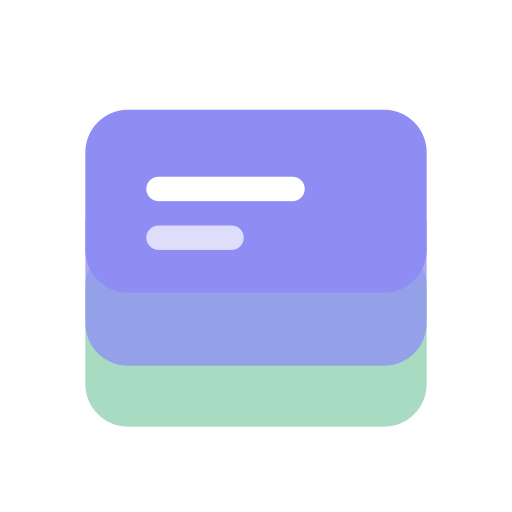
</p>

<h1 align="center">FlowDeck</h1>

<p align="center"><strong>A Claude mod for Claude Code: orchestrate the work, keep the record.</strong></p>

<p align="center">
  FlowDeck plans each task, hands it to a worker on the model that fits, and logs what was asked, done, reviewed and spent. A band above the prompt and a side panel show the crew live, and every finished session is archived as a file you can reopen.
</p>

<p align="center">
  
  
  
  
</p>

<p align="center">
  <a href="#install">Install</a> &middot;
  <a href="#features-at-a-glance">Features</a> &middot;
  <a href="#model-routing">Model routing</a> &middot;
  <a href="CHANGELOG.md">Changelog</a> &middot;
  <a href="#privacy-what-it-reads-writes-and-runs">Privacy</a>
</p>

---

## The problem

Long Claude Code sessions run work the user cannot see. Subagents start and finish out of view, so the user does not know which model did what, what it cost, which task is still open, or why a choice was made. When the session ends, the plan and the decisions go with it.

The real cost is repeated work, lost context and surprise bills.

## The idea

FlowDeck turns each request into a flow of tasks.

- **Orchestration**: the session plans the flow, delegates each task to a worker and reviews the result before accepting it.
- **Logging and history**: every task, run, step, time, cost and handoff note is recorded. Each session is archived as its own file that can be reopened, restored or moved to the Trash.

Every task carries a handoff note behind the `ⓘ` icon, with four parts: Goal and Brief when the task starts, Result and Feedback when it is accepted. Each task's note is logged and archived with its session. More in [Handoff notes](#handoff-notes).

<picture>
  <source media="(prefers-color-scheme: dark)" srcset="docs/images/note-view-dark.png">
  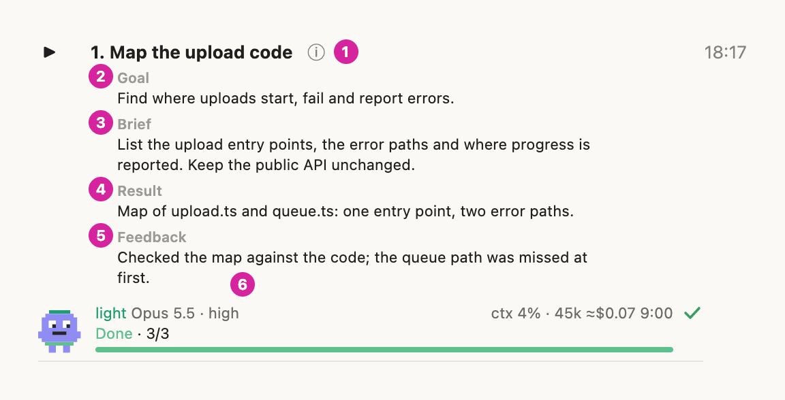
</picture>

1. `ⓘ`: opens or closes the note.
2. Goal: what the task is for.
3. Brief: the start of the worker's delegation prompt.
4. Result: what was achieved.
5. Feedback: the orchestrator's short review.
6. The worker line below the note: tier, model, state and bar.

- **Model routing**: each task goes to the model that fits. Sonnet takes clear, checkable work, Opus takes judgement work, and Fable is used only after the user approves it. The orchestrator assigns the model per task following written routing rules; the mod shows the choice, keeps the tier defaults and enforces the Fable approval in code.
- **Visibility**: a band above the prompt, a side panel with live status, a WARM/COLD cache chip and card, and keep-warm renewals.

A *flow* is the task list for one request. A *task* is one self-contained piece of it. A *worker* is the subagent that does a task. A *handoff note* is the record of a task's goal, brief, result and feedback. The *archive* is the per-project folder of finished sessions.

<picture>
  <source media="(prefers-color-scheme: dark)" srcset="docs/images/band-overview-dark.png">
  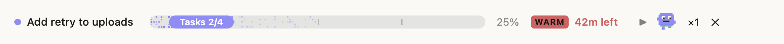
</picture>

<picture>
  <source media="(prefers-color-scheme: dark)" srcset="docs/images/panel-overview-dark.png">
  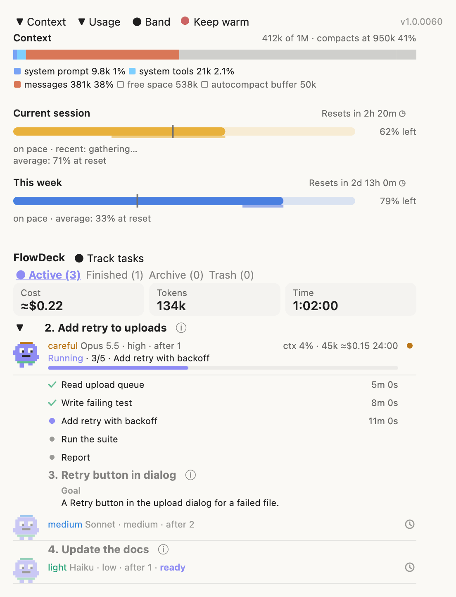
</picture>

The screenshots are rendered from the mod's own drawing code with sample data (see [Screenshots](#screenshots)); nothing in them comes from a real session. In the feature sections below, each screenshot carries numbered circles, and the "What you see" list under it says what each number points at.

## Install

In your shell:

```sh
claude plugin marketplace add paavu/flowdeck-mod
claude plugin install flowdeck@flowdeck-mod
```

Then run `/reload-plugins` in an open session while it is idle (new sessions load the mod by themselves).

### Other ways to install

In one step: `claude plugin install flowdeck --marketplace paavu/flowdeck-mod` from the shell (Claude Code 2.1.292 or later), or `/plugin install flowdeck --marketplace paavu/flowdeck-mod` inside a session (2.1.275 or later). In the desktop app, where `/plugin` does not run: click **+** next to the prompt box, then **Plugins**, **Add marketplace** with `paavu/flowdeck-mod`, then add `flowdeck`.

The install may print `1 userConfig option not yet set`: that is the panel language, which defaults to `auto`; nothing needs setting.

Check it loaded: `/plugin` shows a dim line such as `1 mod active · flowdeck` under its tabs (the count includes other mods).

To see what the mod hooks and calls before you install it, clone the repository and run `claude plugin validate <folder>`: its `hooks:` and `calls:` lines list every event and engine call.

**Overlapping mods.** flowdeck was built from savvy-flow, savvy-progress, context-bar and plan-progress and does what the first three do; plan-progress's separate plans are replaced by the flow's own task list. Running them side by side gives two progress bands and two sets of tools; disable them first (`claude plugin disable <name>@<marketplace>`, or `/plugin`).

**Optional: panel language.** `auto` (default), `en` or `ru`: `claude plugin configure flowdeck@flowdeck-mod`, or `/plugin configure flowdeck@flowdeck-mod` in a session. `auto` follows Claude Code's `language` setting, then `LC_ALL`, `LC_MESSAGES` and `LANG`.

## Your first two minutes

1. Open the panel with `/flowdeck-panel`. It shows the top row, the `FlowDeck` title and the tabs `Active`, `Finished`, `Archive` and `Trash`, all at `(0)` in a new project.
2. On the Active tab, choose `Track all tasks` (or run `/flowdeck-rule on`) so Claude reports every task to flowdeck. Until the user chooses, the mod adds nothing to the system prompt (see [Task tracking](#task-tracking)).
3. Run `/flowdeck:flowdeck <a small task>`. It starts a flow whatever the tracking choice.
4. Watch the band above the prompt (the running task, `Tasks X/Y`, the progress bar) and the Active tab, where each worker appears with its steps.
5. Open a task's handoff note with `ⓘ` and read its Goal, Brief, Result and Feedback.
6. When every task is done and the turn ends, the band reads `Done`; check the Finished tab, then the Archive tab, where the flow is saved.

## Features at a glance

| Feature | What it shows or does |
|---|---|
| [Band](#the-band-above-the-prompt) | One row above the prompt: the running task, `Tasks X/Y`, a progress bar and percent, the cache chip, the running workers and a dismiss button. |
| [Context](#context) | The context window as a stacked bar by category, with the point where auto-compaction runs. |
| [Usage](#usage) | The five-hour and weekly limits as bars that drain, an even-pace mark, a forecast to the reset and the reset time. |
| [WARM/COLD cache chip and card](#the-prompt-cache-chip-and-card) | Whether the prompt cache is still warm (minutes left) or cold (idle time and the cost of the next message), and a card with the cost per model. |
| [Keep warm](#keep-warm) | Renews the prompt cache with one small side request during a long idle stretch; the card says when it renews and how often it did. |
| [Track all tasks](#task-tracking) | One choice for every project: whether Claude reports every task to flowdeck. The Active tab asks on a fresh install; `/flowdeck:flowdeck` always works. |
| [Panel top row and tabs](#the-panel) | Switches for Context, Usage, Band and Keep warm, the version, the `FlowDeck` title with the Track tasks switch, and the tabs `Active`, `Finished`, `Archive`, `Trash` with live counts. |
| [Flows and workers](#flows-and-workers) | A flow is a task list the orchestrator plans and delegates to five worker tiers; each worker row shows its tier, model, effort, `after` waits, state, steps and times. |
| [Handoff notes](#handoff-notes) | A note per task with Goal, Brief, Result and Feedback, opened with `ⓘ`. |
| [Finished](#finished) | Runs that ended (Done, Error, Incomplete) and accepted tasks, latest first. |
| [Archive](#archive-trash-and-empty-trash) | Every finished flow of the project, one foldable row each, kept in `.claude/flowdeck/`. |
| [Trash and Empty Trash](#archive-trash-and-empty-trash) | Archived sessions can be moved to the Trash and restored; `Empty Trash` erases them for good after a confirmation. |
| [Model routing and the Fable approval](#model-routing) | The orchestrator may pick a model per task; the Fable tier launches only after the user approves it in Claude Code's own dialog. |
| [Commands](#commands) | `/flowdeck-panel`, `/flowdeck-rule on, off or status`, `/flowdeck:flowdeck <task>`. |

## Features

Each section below has a screenshot with numbered circles, a "What you see" list that says what each number points at, and a short "How to use".

### The band above the prompt

<picture>
  <source media="(prefers-color-scheme: dark)" srcset="docs/images/band-running-dark.png">
  
</picture>

One row for the open flow.

What you see:

1. The dot and the title: the running task's title (the lowest-numbered one and ` +N` when several run), else the next ready task, else `FlowDeck` once every task is done. It is never the flow's own title. The dot is blue-violet while the flow runs and green when it is finished.
2. The bar: the dense dots are the done share; the faint dots beyond them are tasks handed to workers and not yet accepted; the small ticks mark the task boundaries still ahead.
3. The label on the bar: the phase word and a count, `Tasks X/Y`. Y counts every row the panel's tabs count; X is the running task's number while one runs, else the done count. The phase word becomes `Plan`, `Design` or `Review` in those phases.
4. The percent: the done fraction. The bar and the label turn green and read `Done` when the flow is finished.
5. The cache chip: `WARM` (red) with the minutes left, or `COLD` (blue) with the idle time and the cost of the next message. See [the cache chip and card](#the-prompt-cache-chip-and-card).
6. The chevron: opens and folds the cache card under the band.
7. The worker icon, a small card buddy: it bobs, steps and waves while at least one worker runs and rests still otherwise.
8. `×N`: the workers running now (queued tasks and finished runs do not count; `×0` when none runs). Pressing it opens or closes the panel.
9. `✕`: hides the band only. The panel's `Band` switch, or a new flow, brings it back.

How to use:

- Look at it for where the flow stands; press `×N` for the panel and the chevron for the cache card.
- `✕` hides the band; press `● Band` in the panel's top row to show it again.

A finished flow:

<picture>
  <source media="(prefers-color-scheme: dark)" srcset="docs/images/band-done-dark.png">
  
</picture>

What you see:

1. `FlowDeck`: every task is done, so no task title is left to show.
2. The bar, full and green.
3. `Done`: the label on the bar.
4. `100%`.
5. `×0`: no worker is running; the worker icon stands still.

### Context

<picture>
  <source media="(prefers-color-scheme: dark)" srcset="docs/images/panel-context-dark.png">
  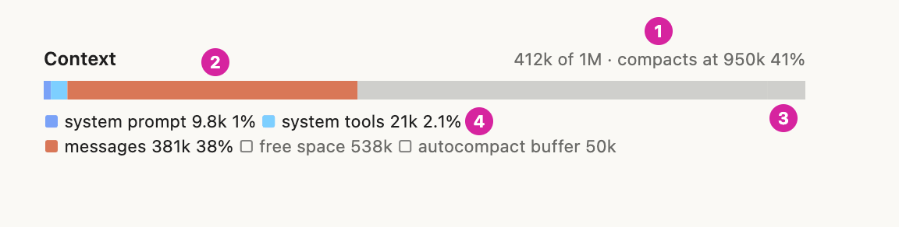
</picture>

The context window of the session, as Claude Code reports it. The section is the panel's first one; `▼ Context` in the top row folds it (folded, it keeps the head line and the bar).

What you see:

1. The head line: tokens used of the window (`412k of 1M`), where auto-compaction runs (`compacts at 950k`) and the used share (`41%`).
2. The bar: the window as a stacked bar, one colour per category (system prompt, system tools, messages).
3. The end of the bar: the autocompact buffer, the room kept for compaction, and the free space before it.
4. The legend: each category with its tokens and share; a hollow square marks free space and the buffer.

How to use: read it to see how close the session is to compaction. Press `▼ Context` to fold it; the choice is remembered.

### Usage

<picture>
  <source media="(prefers-color-scheme: dark)" srcset="docs/images/panel-usage-dark.png">
  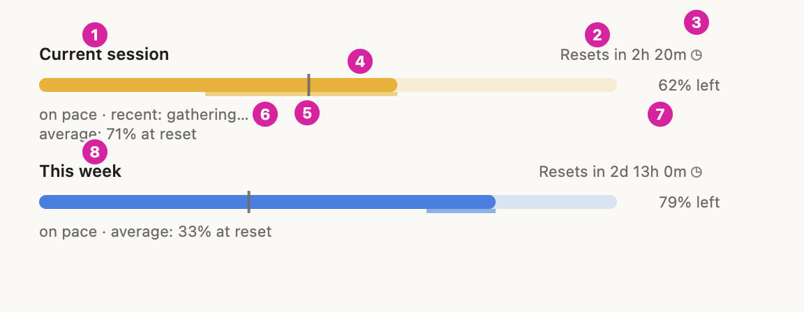
</picture>

The five-hour and weekly rate limits of a Claude subscription (Pro, Max). Without one the section says there is no data yet.

What you see:

1. `Current session`: the five-hour window. The week below it is the seven-day window.
2. The reset as time left (`Resets in 2h 20m`).
3. `◷`: switches every project between time left and the exact time (`Resets at 14:40`).
4. The bar: it drains with use, so its length is what is left. It is amber for the session and blue for the week, and red at 90% used or when the forecast says the limit runs out. The faint strips mark the part of what is left that the forecast says will be used up by the reset: a strip along the bar for the recent pace, a thin one under it for the average.
5. The even-pace mark: where the fill would end if the use were spread evenly over the window. A fill that ends left of the mark means the use is ahead of an even pace; right of it, behind.
6. The forecast: `on pace`, or when the limit would run out (`100% at 14:05, 1h 10m early`); the session shows `recent:` (the last 30 minutes, `gathering…` until there are 5 minutes of readings) and `average:` (since the window began), the week only the average.
7. `62% left`: the percent left.
8. `This week`: the weekly window, drawn the same way.

How to use: look at the mark and the forecast before a long task. Press `◷` to see the reset as a clock time; `▼ Usage` folds the section.

### The prompt cache chip and card

<picture>
  <source media="(prefers-color-scheme: dark)" srcset="docs/images/cache-warm-dark.png">
  
</picture>

Once the main thread has made a request, the chip says `WARM` (red) for an hour after its last request or keep warm's last renewal, then `COLD` (blue). Warm, it shows the minutes left (`42m left`); cold, the idle time and what the next message costs on the session's model (`3h 13m · $3.30`). Subagent requests do not count; `/clear` and `/compact` drop the chip until the next request. Warm starts folded, cold starts open.

What you see (the open card, warm):

1. The chip: `WARM`.
2. The idle time since the main thread's last request (a renewal does not reset it) and the tokens the cache holds.
3. The hour as a bar, with the time left (`cold in 42m`).
4. Keep warm's state (see [Keep warm](#keep-warm)).
5. What one renewal costs, beside what a cold restart costs.
6. The next message's cost on Fable, Opus, Sonnet and Haiku; the caption names the case (`cache read` when warm).
7. `YOU`: the session's model.
8. `prices are estimates`: one table, `MODELS` in `hooks/cache.ts` (USD per million tokens, input and cache read); a cold cache costs the 1-hour cache write (2x input), a warm one a cache read.

<picture>
  <source media="(prefers-color-scheme: dark)" srcset="docs/images/cache-cold-dark.png">
  
</picture>

What you see (cold):

1. The chip: `COLD`.
2. The idle time (`3h 13m`) and the tokens that would be written again.
3. The bar, full, with how long the cache has been cold (`cold for 33m`).
4. Keep warm's record: here two renewals, then `limit reached`.
5. The renewal cost beside the cold restart cost.
6. The caption (`next message, re-cache (1-hour write)`) and the cost on each of the four models.

How to use: press the chevron after the chip to open or fold the card. When the chip is `COLD`, the next message writes the context to the cache again at the cost shown.

### Keep warm

<picture>
  <source media="(prefers-color-scheme: dark)" srcset="docs/images/cache-keep-warm-dark.png">
  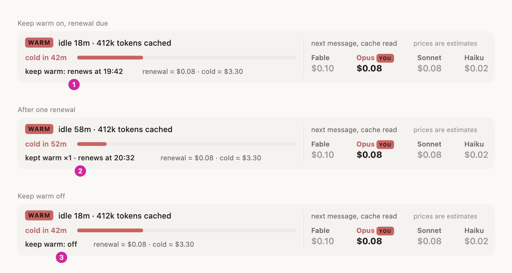
</picture>

Keeps the prompt cache warm through a long idle stretch so the next message reads the context from the cache instead of writing it again.

What you see (the keep warm line of the card):

1. `keep warm: renews at 19:42`: on, waiting for the renewal time.
2. `kept warm ×1 · renews at 20:32`: one renewal done, the next one due.
3. `keep warm: off`: the switch is off. The line can also read `failed` (with `retry at <time>`), `limit reached`, `below 80k tokens` or `not renewed`; after renewals it starts with `kept warm ×N`.

How to use: the `Keep warm` switch (with its dot) in the panel's top row turns it on or off; it is on by default and saved per project folder. Watch the line on the open card.

- **How**: one side request through `$.model.fork`: the main thread's last request again with a one-line prompt asking for `ok`, no tools. Nothing is added to the transcript.
- **When**: 50 minutes after the cache was last read or written (`RENEW_AT_MS`), when the context holds at least 80,000 tokens (`KEEP_WARM_MIN_TOKENS`), no main turn is running and the user has sent nothing since. At most 2 renewals between two of the user's messages (`KEEP_WARM_MAX_RENEWALS`), so an idle session stays warm for about 2 h 40 min, then goes cold.
- **Never**: while the cache is already cold, in the hour's last minute, after the session ended, or with the switch off.
- **Failures**: a failed renewal waits 2 minutes and tries again; after 2 failures in one idle stretch it stops until the user's next message. The card says `failed`; it never shows as an error.
- **Cost**: a renewal is a real request. It costs about a cache read of the context (two renewals of a 770k-token Opus context are about $0.30, against about $6.16 to write it again) and **counts against the plan's usage limits** like any other message.
- **Switch**: the constants are at the top of `hooks/cache.ts`.

### The panel

The panel opens with `/flowdeck-panel`, the band's `×N` button, or by itself when the first worker of a flow starts.

<picture>
  <source media="(prefers-color-scheme: dark)" srcset="docs/images/panel-toggles-dark.png">
  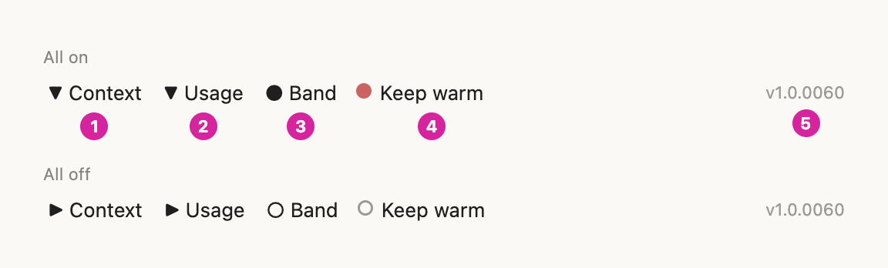
</picture>

The top row, with every switch on and then off.

What you see:

1. `▼ Context`: folds the Context section (`▶︎` when folded, the same glyphs as every fold in the panel). Remembered.
2. `▼ Usage`: folds the Usage section. Remembered.
3. `● Band`: shows or hides the band (`○` hidden).
4. `● Keep warm`: keep warm on or off, per project folder. The dot before the label has the cache's colour while the switch is on: the warm colour while the cache is warm, the cold colour once it is cold, the plain text colour before any request; off, it is a hollow grey `○`.
5. The version of the code that is running.

How to use: press a switch to flip it; `●` is on or shown, `○` is off or hidden. The Keep warm dot is not a button of its own; press the label next to it.

<picture>
  <source media="(prefers-color-scheme: dark)" srcset="docs/images/panel-tabs-dark.png">
  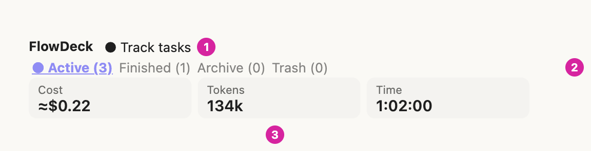
</picture>

What you see:

1. `● Track tasks`, beside the `FlowDeck` title above the tabs: task tracking on or off for every project (`○` until it is on). See [Task tracking](#task-tracking).
2. The tabs, each with its live count: `Active (n)`, `Finished (n)`, `Archive (n)`, `Trash (n)`. One list shows at a time. The selected tab starts with a dot (`● Active (n)`); in the terminal it is also bold, in the accent colour and underlined. Pressing it changes nothing.
3. The tiles: the flow's estimated cost, its tokens and its time.

How to use: press a tab to change the list.

| Tab | Lists |
|---|---|
| Active | The flow's cost, tokens and time, then the running workers (newest first) and the queued tasks in plan order. |
| Finished | Done, Error and Incomplete runs and `Accepted · no worker run` rows, latest first. The rows move to the Archive on their own when the flow closes. |
| Archive | Saved sessions of this project, newest first, one foldable row each; an opened row shows its tasks one level in under it. |
| Trash | Sessions moved to the trash, with `↩` and `Empty Trash (n)`. |

### Commands

| Command | What it does |
|---|---|
| `/flowdeck-panel` | Shows or hides the side panel. `/flowdeck-agents`, its old name, still works in this release. |
| `/flowdeck-rule on`, `off`, `status` | Turns task tracking on or off for every project, or says what the current choice is and what it means (see [Task tracking](#task-tracking)). |
| `/flowdeck:flowdeck <task>` | Starts a flow on the task: plan, design (when the task touches UI), delegate, review, close. A flow already open is saved and replaced. Works whatever the tracking choice. |
| `/flowdeck:flowdeck` | With no task: adopts the work already under way in the session into a flow. |

The skill (`skills/flowdeck/SKILL.md`) tells the orchestrator how to plan, how to pick a tier and how to review.

### Flows and workers

<picture>
  <source media="(prefers-color-scheme: dark)" srcset="docs/images/panel-flow-dark.png">
  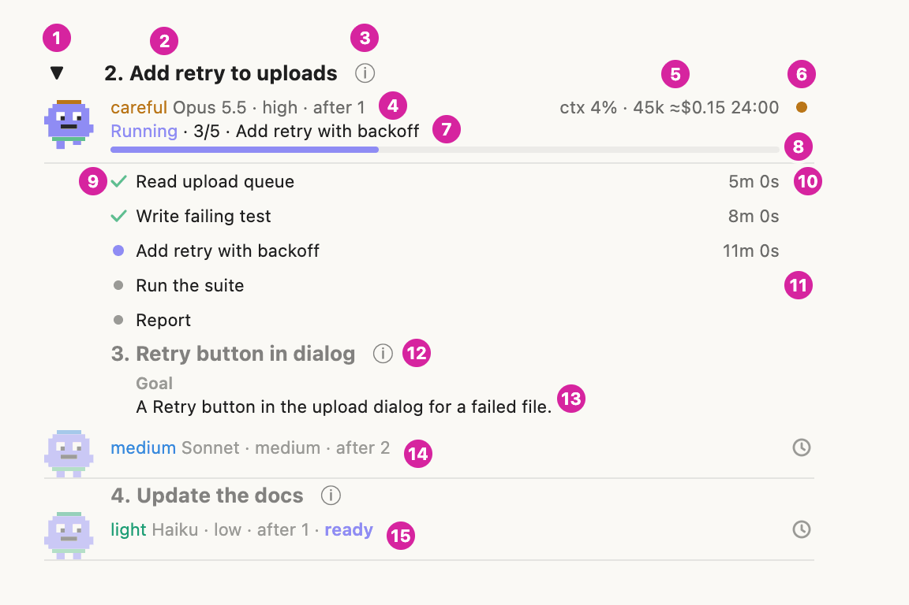
</picture>

A flow is the session's task list. The orchestrator plans it, delegates each task to one of five worker agents and reviews every result; the panel draws each worker run as a row.

What you see:

1. The fold glyph (`▼` open, `▶︎` folded): opens or closes the worker's steps.
2. The task number and title. Queued rows are dim.
3. `ⓘ`: opens the task's handoff note.
4. `careful Opus 5.5 · high · after 1`: the tier (coloured), the model, the effort and the tasks it waits for (`after 1`, `after 2, 3`).
5. `ctx 4% · 45k ≈$0.15 24:00`: context use, tokens, estimated cost and the time the run has taken.
6. The state mark: `●` running, `✓` done, `✗` error, `◐` incomplete, `◷` queued.
7. The state word in colour, with the step now worked on out of the step count and its title (`Running · 3/5 · Add retry with backoff`); with no step, the live tool (`Running · Bash`).
8. The bar: fills as the worker finishes steps. A worker sends its plan once and moves it as each step finishes.
9. The steps, each with its mark: `✓` done, a dot for the running one, a grey dot for the ones still to do.
10. The time a step took.
11. A step not started shows no time. It shows `–` instead of a time when the worker closed it in the same call as other steps it never started (a batch close at the end): the mod does not guess how long those took.
12. A queued task with its note open (`ⓘ`).
13. The note's Goal: queued rows have it from the moment the task is planned.
14. A queued row's line: the tier, the model and effort the task will run with, and what it waits for. `◷` at the end marks it as queued.
15. A queued task with a model of its own (here `Haiku`) and `ready`: every task it waits for is done, so it can start now, in parallel with others.

How to use:

- Press the fold glyph to read a worker's steps and `ⓘ` for its note; nothing needs pressing to follow a flow.
- To keep the list current, the mod adds one line to a worker's tool result ("update your step list now") after 8 tool calls without a step call; the user never sees that line.

| State | Colour |
|---|---|
| Running (with the live tool, `Running · Bash`) | blue-violet |
| Needs approval | amber |
| Done | green |
| Incomplete (ended, steps left) | amber |
| Error | red |

A finished row shows when it finished (`14:07`, or `Oct 29 · 14:07` on an earlier day). The mod links each run to its planned task by itself: by the `#n` at the start of the Agent description, else the exact title, else the closest title, else the only open task of the worker's tier.

Five worker agents ship with the mod; the orchestrator picks the cheapest one likely to get the task right:

| Agent | Model / effort | For |
|---|---|---|
| `flowdeck-light` | Sonnet / low | Mechanical edits, renames, config, running builds and tests |
| `flowdeck-medium` | Sonnet / medium | Standard features, bug fixes with a known cause |
| `flowdeck-careful` | Opus / high | Delicate work: multi-file refactors, invariants, many edge cases |
| `flowdeck-heavy` | Opus / xhigh | Unfamiliar code, unclear root causes, non-obvious architecture |
| `flowdeck-fable` | Fable / high | Used only after the user approved it, for a task that failed on Opus heavy |

Tasks that edit the same files are chained with `after` and never run in parallel. Workers never make design decisions unless the brief gives them one.

#### Tools the model calls

| Tool | Called by | Purpose |
|---|---|---|
| `mcp__flowdeck__progress` | the main session | The flow's title and phase, its tasks (`title`, `tier`, `after`, `goal`), `add` for a new task, `done: [numbers]` for accepted tasks, `notes` for handoff notes, `finished` and `restart`. One call can carry `add`, `done` and `notes` together. |
| `mcp__flowdeck__step` | workers | A worker's own plan as a `steps` list, then `next`, `done`, `active`, `failed`. |

The flow's task list is the only task list: there is no separate plan tool.

#### Automatic flow lifecycle

There are no Start or Finish buttons.

- **Start**: the first `progress` call starts a flow. So does a task list (TodoWrite or TaskCreate) with an open item, or a flowdeck worker launched while no flow is open.
- **Finish**: when the main turn ends with every task done and no worker running, the flow finishes by itself. A flow with nothing running or queued finishes after 30 minutes idle (`IDLE_FINISH_MS` in `hooks/live.ts`). A finished flow is archived at once and stays in Finished and on the band (`Done`) until the next task starts a new flow.
- **Across restarts**: the open flow is written to `.claude/flowdeck/flow-live.json` as it changes. The next session restores its own flow, and closes and archives a flow another session left once that session ended or has been quiet for 3 minutes. Runs that were still going read `Running at finish`.

### Handoff notes

<picture>
  <source media="(prefers-color-scheme: dark)" srcset="docs/images/panel-finished-dark.png">
  
</picture>

Every task row can carry a short note so whoever reviews the list knows what each task was about and how it ended. Below, "the orchestrator" is the Claude session running `/flowdeck`, and "the mod" is flowdeck itself.

What you see:

1. `ⓘ`: opens the note directly under the task's title, above the worker line, the progress bar and the steps. Every row with a note, queued, running, finished or archived, has it.
2. Goal: the optimized summary of the user's request.
3. Brief: the start of the worker's delegation prompt, taken by the mod.
4. Result: what was achieved.
5. Feedback: the orchestrator's short review.

How to use: press `ⓘ` to open the note and again to close it.

| Part | Written by | When |
| --- | --- | --- |
| Goal | the orchestrator: an optimized summary of the user's request (a sentence or two) | when it creates or adds the task, so queued rows have it too |
| Brief | the mod, taken automatically from the worker's delegation prompt | when the worker starts |
| Result | the orchestrator: what was achieved | when it accepts the task |
| Feedback | the orchestrator: a short review | when it accepts the task |

Caps: goal 300, brief 600, result 300 and feedback 300 characters; the mod cleans each part to plain text and cuts it at a word with `…`, whatever the caller sends.

The brief leaves out headings, code fences and common preamble lines (repository line, tool and commit rules, the step-list closing line) and keeps the start of the real task text; a return round's prompt replaces it until the task is accepted. The orchestrator can change any part later through `notes` (an empty string clears it), but a finished flow takes no notes. Notes are saved with the flow, so the Archive shows them too.

### Finished

<picture>
  <source media="(prefers-color-scheme: dark)" srcset="docs/images/panel-finished-list-dark.png">
  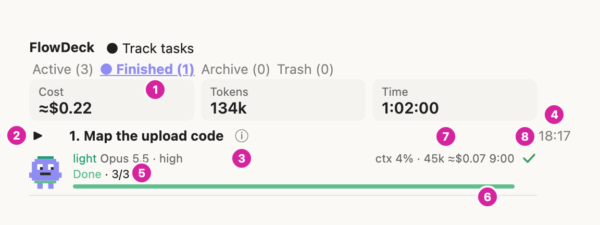
</picture>

Runs that ended: `Done`, `Error` and `Incomplete` runs, and `Accepted · no worker run` rows, latest first. The flow's rows move to the Archive on their own when the flow closes.

What you see:

1. The `Finished (n)` tab with its live count.
2. The fold glyph (`▶︎` folded): opens the run's steps; then the task number and title.
3. `ⓘ`: the handoff note.
4. When the run finished (`18:17`, or `Oct 29 · 14:07` on an earlier day).
5. The end state in colour with its step count: `Done · 3/3`.
6. The bar, full and green for a done run.
7. Context use, tokens, estimated cost and time.
8. The state mark (`✓`).

How to use: open a row's note or steps to review it; there is nothing to press to archive, the flow does it when it closes.

### Archive, Trash and Empty Trash

<picture>
  <source media="(prefers-color-scheme: dark)" srcset="docs/images/panel-archive-dark.png">
  
</picture>

What you see (Archive):

1. The `Archive (n)` tab: the saved sessions of this project.
2. A session row: the fold glyph, the date and time the session ended, and the number of tasks. Opened, it shows cost, tokens and time as three tiles and its tasks below.
3. The trash can: asks before moving the session to the Trash.
4. A task of the opened session, one level in under its row (number, title, `ⓘ`, finish time, steps).
5. A folded session: its cost, tokens and time as one dim line.
6. The confirmation: what the session is, and what moving it does (it leaves the Archive and shows in the Trash tab; its file is copied to `.claude/flowdeck/.trash/`; nothing is erased).
7. `Move to trash` (or `Cancel`).

How to use: fold or open a session row to read it; press the trash can and then `Move to trash` to put a session away.

<picture>
  <source media="(prefers-color-scheme: dark)" srcset="docs/images/panel-trash-dark.png">
  
</picture>

What you see (Trash):

1. The `Trash (n)` tab.
2. `Empty Trash (2)`: erases every trashed session for good, after a confirmation.
3. A trashed session, laid out as in the Archive.
4. `↩`: asks first, then moves the session back to the Archive.

<picture>
  <source media="(prefers-color-scheme: dark)" srcset="docs/images/panel-trash-confirm-dark.png">
  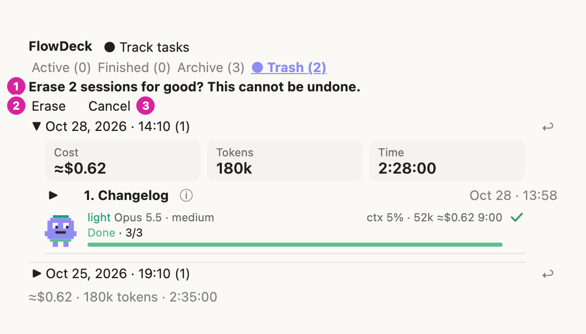
</picture>

What you see (after `Empty Trash`):

1. `Erase 2 sessions for good? This cannot be undone.` (`Erase 1 session…` for one).
2. `Erase`: erases the sessions.
3. `Cancel`: nothing happens. Leaving the Trash tab also cancels.

How to use: press the `↩` of a session to restore it, or `Empty Trash (n)` and then `Erase` to remove all of them.

- **Archive**: one file per saved session (a flow, or a finished plan an older version saved) in `.claude/flowdeck/archive/`, listed by `archive-index.json`. The list draws from the index alone; a session's file is read only when its row is opened. A folded row shows its cost, tokens and time as one dim line; an opened session shows them as the same three tiles the Active and Finished tabs use (the terminal keeps the one line).
- **Move to trash** (the trash can on a session row): asks first, then copies the session to `.claude/flowdeck/.trash/` and hides it from the Archive. Nothing is erased.
- **Restore** (`↩` on a Trash row): asks first, then moves the session back to the Archive.
- **Empty Trash (n)**: asks `Erase n sessions for good? This cannot be undone.` with `Erase` / `Cancel`, then erases each trashed session's files permanently, with no system trash and no undo. This is the only place flowdeck deletes a file. It erases only files whose names the archive itself gives the trashed sessions, directly inside `.trash/` or `archive/`, never a link, one file at a time; a session that cannot be erased whole stays in the Trash and the tab says how many failed.

### Model routing

Each tier has a default model (the table under [Flows and workers](#flows-and-workers)). The orchestrator may pick another per task, with the Agent tool's `model` argument: `sonnet` for clear-spec work a test can check, `opus` for judgement and delicate or unfamiliar work, `haiku` only for pure search-and-run jobs. It sends the same value as the task's `model` in the plan (`sonnet`, `opus` or `haiku`; Fable is not selectable there), and a queued row then reads `<tier> · <Model> · <effort>` with that model instead of the tier's default (callout 15 in the flow row above). A running or finished row shows the worker's real model.

A task that fails review on Sonnet goes to Opus careful (Opus heavy if the cause is unclear), one that fails on Opus careful to Opus heavy. One that fails on Opus heavy is never sent to Fable automatically: the orchestrator tells the user which task failed and why, and uses `flowdeck-fable` only after the user says yes. The orchestrator itself may run on any model.

**Fable approval guard.** The rule above is also enforced in code, so it holds even if a model ignores the text. Every Agent launch that names `flowdeck-fable` (or `flowdeck:flowdeck-fable`) as `subagent_type`, or `fable` as `model`, is held while the mod asks the user, in Claude Code's own question dialog: `flowdeck wants to use Fable (the reserve tier) for: <task description>. Reason: <the start of the brief>. Approve?` with `Approve` and `Decline`. That dialog belongs to Claude Code, not to the mod, so it has no screenshot here. The orchestrator is told to state at the top of the Fable brief which task failed on Opus heavy and why; that text is the reason shown (first 300 characters). Approving lets that one launch run; the next Fable launch asks again. Declining, dismissing the question, or running where nobody can be asked (such as `claude -p`) denies the launch, and the orchestrator is told to keep the task on Opus heavy or report to the user, not to retry Fable. If the guard itself fails, the launch is denied. Every other Agent call passes through unchanged. The guard is always on, independent of task tracking, and has no setting to turn it off.

How to use: answer the dialog when it appears; `Approve` runs that one Fable launch, `Decline` keeps the task on Opus heavy.

## Task tracking

A fresh install has not chosen yet; the Active tab asks:

<picture>
  <source media="(prefers-color-scheme: dark)" srcset="docs/images/panel-tracking-unset-dark.png">
  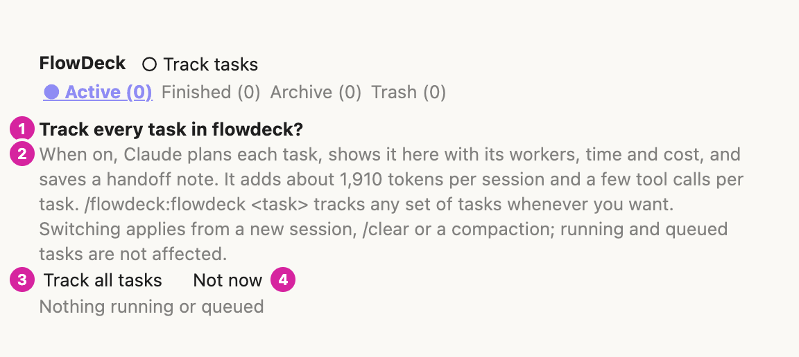
</picture>

What you see:

1. The question. It shows on the Active and Finished tabs until the user chooses; until then the mod adds nothing to the system prompt.
2. What tracking does and what it costs in tokens, and when a switch applies (a new session, `/clear` or a compaction).
3. `Track all tasks`: turns tracking on for every project.
4. `Not now`: turns it off; the strip then says `Task tracking is off`.

How to use: press `Track all tasks` to have every task reported, or `Not now` to leave it off and still start flows with `/flowdeck:flowdeck <task>`.

With tracking off, the strip stays as a reminder with one button:

<picture>
  <source media="(prefers-color-scheme: dark)" srcset="docs/images/panel-tracking-off-dark.png">
  
</picture>

What you see:

1. `Task tracking is off`: the current choice.
2. The same explanation as on a fresh install.
3. `Track all tasks`: turns tracking on. The `● Track tasks` switch beside the `FlowDeck` title above the tabs does the same, and `/flowdeck-rule on` or `off` from the prompt.

How to use: switch tracking from the strip, the switch beside the `FlowDeck` title or `/flowdeck-rule`; the choice is kept for every project.

Task tracking decides whether the mod puts its flow rule (`flowdeck:flow-rule`) into the system prompt of every session. The rule tells Claude to report every task through `progress`: the plan once with `title` and `tasks` (`title`, `tier`, `after` for tasks that edit the same files, `goal`), `add` for a new task, `done` with `result` and `feedback` notes when a task is accepted, and `#<n> <title>` at the start of each worker's Agent description; a question or a one-step edit gets no flow. It blocks no edit or tool call.

| Choice | The system prompt | Set by |
|---|---|---|
| `unset` | Nothing is added. The Active and Finished tabs show `Track every task in flowdeck?` with `Track all tasks` and `Not now`. | A fresh install |
| `on` | The flow rule is added to every session. No strip. | `Track all tasks`, `● Track tasks` beside the `FlowDeck` title, `/flowdeck-rule on` |
| `off` | Nothing is added. The Active and Finished tabs show `Task tracking is off` with `Track all tasks`. | `Not now`, `○ Track tasks`, `/flowdeck-rule off` |

- **One choice for every project**, kept in Claude Code's mod store (key `rule`). Switching applies when the prompt is next composed (a new session, `/clear` or a compaction); running and queued tasks are not affected. A switch never changes a flow, a task or a worker that already exists.
- **A flow that starts by itself stays quiet.** With tracking `unset` or `off`, a flow that starts from the session's own task list or from a flowdeck worker appears in Active and Finished and on the band, but the panel does not open by itself; `/flowdeck-panel` opens it. With tracking `on`, and for a flow started by `/flowdeck:flowdeck`, the panel opens once for the flow. Turning tracking on later does not open a flow that already started.
- **`/flowdeck:flowdeck <task>` always works**: the skill carries every rule in `SKILL.md`, and the mod adds the flow rule for the rest of that session too (held in the session's state, never stored), whatever the choice.
- **`/flowdeck-rule status`** says the current choice and what it means. The strip never shows on the Archive and Trash tabs.
- **Existing installs (migration in 1.0.0037)**: when the store holds no `rule` yet, the first session start decides once. If the mod ran before (any of its earlier store keys `history`, `keepWarm`, `contextShown`, `usageShown`, `usageRemaining` or `historyShown` is set, or the project's `.claude/flowdeck/` holds `flow-live.json`, `archive-index.json`, `archive/`, `archive-migrated.json` or a `history*.json`), the choice is saved as `on`, so tracking works as before. Otherwise it is saved as `unset`, so a new user's own later flows never turn it on. A store that cannot be read decides nothing and adds nothing.

### What it costs

Measured on Claude Code 2.1.312. Prose is estimated at about 3.6 characters a token (no tokenizer is available to the mod); tool schemas are given as Claude Code's `/context` counts them (about 2 characters a token of their JSON), and `/context`'s rounded System prompt total is shown too.

| Part | When it is read | 1.0.0036 | 1.0.0037 |
|---|---|---|---|
| Flow rule (system prompt) | every request while tracking is on (before: always) | 896 characters, about 250 tokens; `/context` System prompt +0.3k | 476 characters, about 130 tokens; +0.1k, and nothing while `unset` or `off` |
| `progress` tool schema | once the main session loads the tool | 4,689 characters, `/context` 2.3k tokens | 3,246 characters, `/context` 1.6k tokens |
| `step` tool schema | once a worker loads the tool | 1,516 characters, `/context` 758 tokens | 1,274 characters, `/context` 638 tokens |
| `SKILL.md` | when `/flowdeck:flowdeck` runs | 16,712 characters, about 4,640 tokens | 16,828 characters, about 4,670 tokens |

With tracking on, the main session pays about 1,760 tokens (the rule and the `progress` schema; the strip's number is computed from the same texts) and a few `progress` calls per task. With tracking `unset` or `off`, the tools are listed by name only (deferred) and the system prompt is unchanged.

## Configuration and data

| Setting | Where | Default |
|---|---|---|
| Panel language | `claude plugin configure flowdeck@flowdeck-mod` | `auto` |
| Context, Usage folded | panel top row (mod store `contextShown`, `usageShown`) | shown |
| Reset as time left or exact time | `◷` in Usage (mod store `usageRemaining`) | time left |
| Keep warm | panel top row (mod store `keepWarm`, per project folder) | on |
| Task tracking | `Track tasks` beside the `FlowDeck` title, the strip's buttons, `/flowdeck-rule` (mod store `rule`, all projects) | `unset` on a fresh install, `on` for an install that ran before 1.0.0037 |
| Band shown | panel top row (per session) | shown |
| Cache prices | `MODELS` in `hooks/cache.ts` | Fable 10 / 0.25, Opus 4 / 0.20, Sonnet 2 / 0.20, Haiku 0.5 / 0.05 USD per million tokens |
| Keep warm timing | top of `hooks/cache.ts` | renew at minute 50, at least 80,000 tokens, at most 2 renewals |
| Idle finish | `IDLE_FINISH_MS` in `hooks/live.ts` | 30 minutes |

All times are 24-hour `HH:MM`.

**Where data lives.** Per project, in `<project>/.claude/flowdeck/` (the session's working folder). The mod writes a `.gitignore` containing `*` into that folder before its first file, so nothing there is committed.

| File | Holds |
|---|---|
| `archive/<key>-<start>.json` | One saved session: a flow (up to 60 runs, 12 steps per run, 100 tasks with their notes), or a finished plan an older version saved |
| `archive-index.json` | One small record per session (about 330 bytes); the Archive tab draws from it |
| `flow-live.json` | Each running session's open flow, for restoring it after a restart |
| `.trash/` | Copies of trashed sessions and `trash-index.json`; `.trash/damaged/` keeps an index that could not be parsed before it is rebuilt |
| `history*.json`, `archive-migrated.json` | The archive format before 1.0.0025, read once by a migration and never written again |

**Size guards.** Sizes are UTF-8 bytes. No file over 3,900,000 bytes is written (the engine reads and writes at most 4 MiB a file); a session too big for its file goes to the mod store instead and the Archive says so. Past 2,500,000 bytes (about 7,500 sessions) the Archive warns that the index is large. A file that exists but cannot be read is never written over, and a damaged index is kept before it is rebuilt.

Without a project folder, or when the folder cannot be written, saves go to Claude Code's mod store (key `history`), so nothing is lost.

## How it works

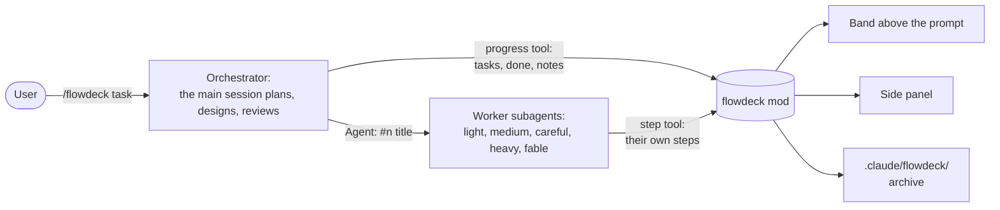

The session model is the orchestrator: it reads the code, splits the work into self-contained tasks, picks a worker tier for each, delegates, and reviews every result before accepting it. It reports the plan and each accepted task through the `progress` tool; each worker reports its own steps through the `step` tool. The mod draws all of it and saves finished flows per project.

## Privacy: what it reads, writes and runs

flowdeck makes **no network calls of its own**: there is no `fetch`, no HTTP and no telemetry in the code. Everything it keeps stays on the local machine.

| Kind | What |
|---|---|
| Model requests | Keep warm's renewal, `$.model.fork` (`hooks/register.tsx`, `renewCache`): one request to the model provider the session already uses, over the session's own transcript. Off with the `Keep warm` switch. |
| Processes | `$.process.run`, only from `Empty Trash` (`eraseSessionFile` in `hooks/archive-store.ts`): `unlink <file>` on macOS and Linux, `powershell.exe -NoProfile -NonInteractive -Command Remove-Item -LiteralPath …` on Windows (the path passed in the environment). No shell, one file per call, 15-second timeout. |
| Files written | Only under `<project>/.claude/flowdeck/` (`$.fs.write`): the files listed above and the folder's `.gitignore`. |
| Files read | The same folder (`$.fs.read`, `$.fs.list`, `$.fs.stat`, `$.fs.exists`). |
| Session data | Context breakdown and rate limits (`$.session.usage`), the session's model and id, agent launches with their description and prompt (the first ~600 characters of a worker's prompt become its brief), the name of each tool a worker calls (the live `Running · <tool>` word), TodoWrite, TaskCreate and Agent calls, permission requests (to show `Needs approval`), whether a prompt was typed by the user (keep warm's count), turn usage (tokens and cost), and the transcript path from `SessionStart` (kept to recognise the session after a restart). |
| Settings and env | `language` from Claude Code's settings, `LC_ALL`, `LC_MESSAGES`, `LANG`; only to pick the panel language. |
| User prompts | The Fable approval guard (see [Model routing](#model-routing)) asks one question through `$.ui.ask` before a Fable launch, with the task description and the first 300 characters of the brief. Nothing is stored or sent. It is always on and cannot be disabled. |
| System prompt | Adds the flow rule only while task tracking is on, or in a session that ran `/flowdeck:flowdeck` (see [Task tracking](#task-tracking)). |

What it saves (task titles, goals, briefs, results and feedback, costs and times) is what the user and the orchestrator wrote during the session. It stays in the project folder, git-ignored.

## Updating and uninstalling

### Update

```sh
claude plugin update flowdeck@flowdeck-mod
```

then `/reload-plugins` in open sessions. Every release raises `version` in `.claude-plugin/plugin.json`, so `update` always sees the new one. The panel's top row shows the version of the code that is running (`v1.0.0059`); after an update without a reload it still names the old one. [CHANGELOG.md](CHANGELOG.md) lists what each version changed.

From 1.0.0036 or earlier: task tracking became a choice in 1.0.0037. An install that already ran flowdeck keeps its rule (`on`); see [Task tracking](#task-tracking) for how that is decided. `/flowdeck-agents` still opens the panel for this release; its new name is `/flowdeck-panel`.

From 1.0.0034 or earlier: the Plans tab and the `plan` tool are gone (1.0.0035). An old `plans.json` is ignored and never deleted, and a panel left on the Plans tab opens on Active.

### Uninstall

```sh
claude plugin uninstall flowdeck@flowdeck-mod
claude plugin marketplace remove flowdeck-mod
```

Saved flows stay in each project's `.claude/flowdeck/` folder (git-ignored), with any `plans.json` an older version left there. Move that folder to your system's trash if you want them gone.

## Troubleshooting

| Problem | Try |
|---|---|
| Nothing changed after install or update | `/reload-plugins`, or start a new session. Check `/plugin` lists `flowdeck` among the active mods. A `/reload-plugins` typed while a turn is still running is queued and runs only when that turn ends, so the old code keeps showing until then; run it when the session is idle, or wait for the turn to finish. |
| The band is gone | Press `Band` in the panel's top row (`/flowdeck-panel` opens the panel). `✕` on the band only hides it. |
| The band never shows, and `Band` cannot bring it back | Another mod that draws above the prompt and is listed before flowdeck in `enabledPlugins` (in `~/.claude/settings.json`) can answer the band without passing it on, so flowdeck's hook never runs. Mods nest in the order of `enabledPlugins`, first outermost: move `"flowdeck@flowdeck-mod": true` above such mods, then `/reload-plugins`. The `replay-theater` sample mod, for one, takes the band after a turn that edited files. |
| A line `band error: …` under the top row | The band could not be drawn for that reason; flowdeck gives way to what other mods draw and says so once. `/reload-plugins` clears it. `claude --debug` logs the details. |
| A panel button does nothing | The desktop app may have pressed an old handle while the panel redrew; press again. Right after `/reload-plugins` the app refuses presses on buttons drawn before the reload until it redraws the panel. |
| `could not be drawn` in a part of the panel | That part threw; the rest still draws. `/reload-plugins`, and report it with the line's text. |
| `… is drawn as text: its drawing is too large for the panel` | On the desktop the tab's drawings would make the panel larger than the desktop app takes (it would keep the old panel and refuse its presses, and a reopened panel would stay blank), so the tab draws its text rows instead. Folding Archive sessions you are not reading makes it smaller. |
| Check the install | `claude plugin validate <folder>` on a clone must end with `✔ Validation passed`. |

## Development

```sh
git clone https://github.com/paavu/flowdeck-mod
cd flowdeck-mod
claude plugin validate .        # ✔ Validation passed
claude plugin test .            # the whole suite
sh scripts/check-version.sh     # the three version places agree
sh scripts/check-rules.sh       # SKILL.md carries every flow rule by itself
sh scripts/check-readme.sh      # README images exist, have alt text, and each legend matches its callouts
```

To run your working copy, add the folder as a marketplace (`claude plugin marketplace add ./flowdeck-mod`, then install `flowdeck@flowdeck-mod`): a folder marketplace is read in place, so `/reload-plugins` picks up edits. Or start a session with `claude --plugin-dir ./flowdeck-mod`.

| Path | What |
|---|---|
| `hooks/register.tsx` | The hooks module: events, tools, the band and the panel |
| `hooks/*.ts`, `hooks/*.tsx` | Pure parts: archive store and index, cache and keep warm, notes, archived plans, tasks, usage, context |
| `skills/flowdeck/SKILL.md`, `agents/` | The orchestrator skill and the five worker agents |
| `tests/` | The suite (`claude plugin test .`) |
| `types/index.d.ts` | The `$.state` contract |
| `docs/` | Design notes and the build ledger (history, not user documentation) |

**Versions** are `M.m.xxxx`: every build raises the 4-digit build number. A release changes three places together: `version` in `.claude-plugin/plugin.json`, `VERSION` in `hooks/version.ts` and a new top heading in `CHANGELOG.md`. `tests/version.test.tsx` fails when the first two differ; `scripts/check-version.sh` checks all three.

**Releasing**: bump the version, run `claude plugin test .`, `claude plugin validate .`, `sh scripts/check-version.sh` and `sh scripts/check-readme.sh`, commit, tag `v<version>` and push the tag.

### Screenshots

`sh scripts/screenshots.sh` renders the images in `docs/images/`. It runs `scripts/screenshots/shots.tsx` through the engine's test kit (sample flows, a warm and a cold cache, archive sessions; no real session data), prints each drawn tree, and `scripts/screenshots/render.mjs` lays the trees out as HTML and captures them with [agent-browser](https://github.com/vercel-labs/agent-browser), light and dark. The mod's own SVG drawings are used as drawn; the desktop app's native elements (text, buttons, boxes) are approximated with plain CSS. `docs/images/src/` keeps each page's HTML and the band and cache-card SVGs. Times in the images are in the local time zone of the machine that rendered them. Smaller PNG files come from ImageMagick (`magick`, a 96-colour palette) when it is installed.

**Callouts.** The numbered circles are data, not drawing code: `scripts/screenshots/callouts.tsv` has one line per circle (image name, number, the part it points at, which side it sits on, a nudge). A part is found by the key of the element the mod drew, by its text, or, for what the mod draws as one picture (the band, the context bar, a step row), by a point in that picture. `render.mjs` places the circles in the page before the capture and adds a thin leader line to a nudged one. The text of each legend is in this README; `sh scripts/check-readme.sh` fails when a legend has a different number of items than the data has circles. To move or add a callout, edit the `.tsv` and run `sh scripts/screenshots.sh`.

## Requirements

| | |
|---|---|
| Claude Code | **2.1.295 or later**. The full test suite passes on 2.1.295 and 2.1.312 (built and tested on 2.1.312); 2.1.212 refuses the manifest (`userConfig` `options` needs 2.1.271). Mods themselves need 2.1.287 in the terminal and 2.1.286 in the desktop app. |
| Surfaces | Terminal (`claude`) and the Code tab of the Claude desktop app. Both draw the band and the panel; the desktop draws them as graphics, the terminal as text. `claude -p` and the Agent SDK run the hooks but draw nothing. |
| Models | The `flowdeck-fable` worker runs on the Fable model; without access to it, change `model:` in `agents/flowdeck-fable.md`. The `light` and `medium` workers run on Sonnet, `careful` and `heavy` on Opus. |
| Usage section | A Claude subscription that reports rate limits (Pro, Max). Without one the section says there is no data yet. |
| Empty Trash | `unlink` on macOS and Linux, `powershell.exe` on Windows (see [Privacy](#privacy-what-it-reads-writes-and-runs)). |

## Known limits

- The terminal text is English only; the `ru` language covers part of the panel.
- No sounds.
- No edit gate: work is never blocked by the mod.
- No separate plans (removed in 1.0.0035): the flow's task list is the only task list. A `plans.json` or `plans-extra-<session>.json` an older version left in `.claude/flowdeck/` is ignored and never deleted; plans an older version saved to the Archive still show there.
- A worker still running when its flow is saved is kept as `Running at finish`; what it spends after that is not recorded.
- Handoff notes sent after a flow finished are ignored: send `result` and `feedback` with the `done` that accepts the task.
- The archive index is one file: past about 7,500 sessions it warns, and past 3,900,000 bytes it can no longer be written (the session files are kept). Index volumes would fix this; they are not built.
- The engine's file API cannot move or delete, so a trashed session keeps its file in `archive/` as well as its copy in `.trash/` until `Empty Trash`. Its small index record stays, hidden.
- Two sessions saving at once can each write the index without the other's session for a moment; the next load lists it again.
- A session that ends without its end being written (a crash) looks alive for 3 minutes, so the next session closes its flow up to 3 minutes later.
- On the desktop, a button pressed right as the panel redraws can land on an old handle and be ignored; while workers run, the panel redraws every 5 seconds, so elapsed times move in 5-second steps.
- The cache chip assumes Claude Code's 1-hour prompt cache, and its prices are estimates.
- Keep warm was tested through the test kit only (with `$.model.fork` answered by the test), not yet measured in a live session. A renewal can come up to 5 seconds after minute 50; while the machine sleeps nothing runs.
- The token numbers in [What it costs](#what-it-costs) are estimates: no tokenizer is available to the mod, and `/context` estimates too. The session switch from `/flowdeck:flowdeck` was tested through the test kit's `skill.prompt` only, not in a live session.
- A task list (TodoWrite) or a flowdeck worker still starts a flow in the panel while tracking is `unset` or `off`; that adds nothing to the system prompt.
- The `ⓘ` glyph and the desktop layout estimates (chevron width, the cache chevron's room) were checked in tests, not measured in a live desktop window.

## Credits and license

flowdeck is MIT-licensed: see [LICENSE](LICENSE). It is built from these MIT-licensed mods, whose notices are in [NOTICE.md](NOTICE.md):

- savvy-flow and savvy-progress (claude-kit, johnnyvizz): the orchestrated flow, the worker agents, the band and the agents panel
- context-bar (claude-code-mods, Hamza Zafar): the context window section
- plan-progress (zycck-mods, Kirill Serditov): the plan model and its drawing, used for plans an older version archived
- ribbon (RoboNuggets): the prompt-cache WARM/COLD idea and its cost method, reimplemented

Keep warm's renewal method follows the idea of Cache Bell (claude-mods.com/cache-bell); no code was taken from it.
